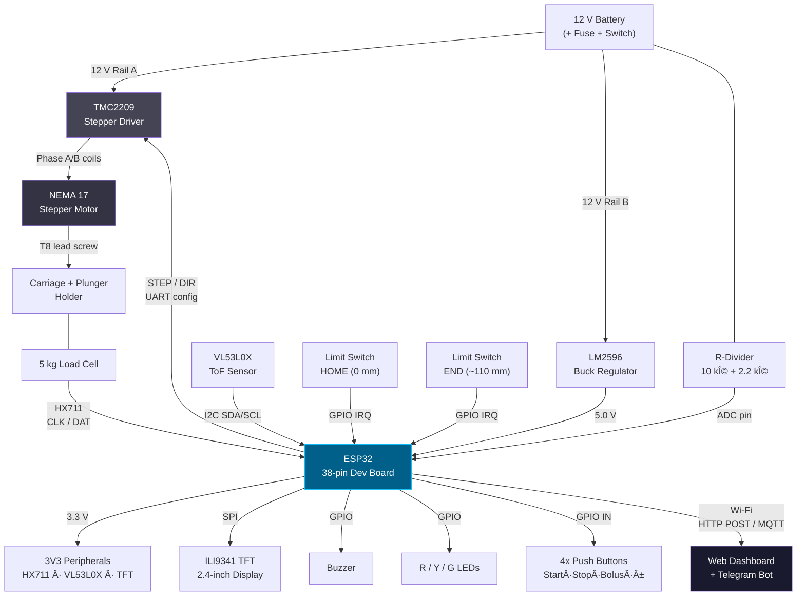
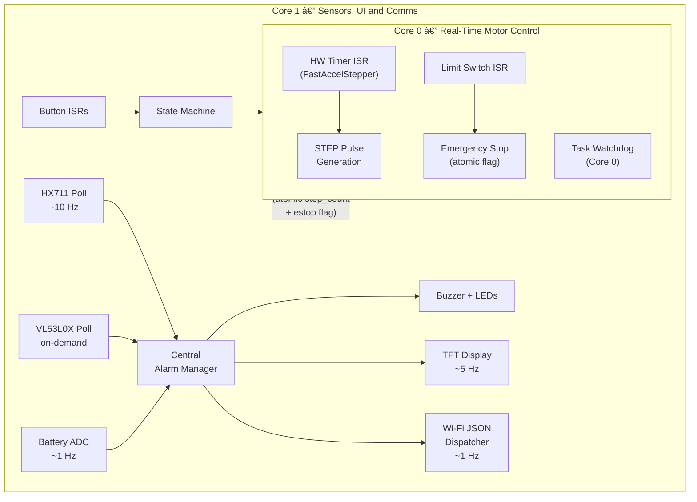
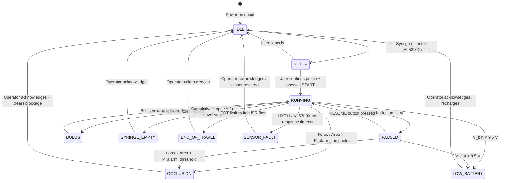

# 💉 Smart Syringe Infusion Pump with Remote Monitoring

> **3YP Learning Prototype — Computer Systems Design Project (CO3060 · 2026)**


---

> [!CAUTION]
> **Medical Safety Disclaimer — Read Before Proceeding**
>
> This project is an **experimental educational prototype** developed by a student engineering team as part of a third-year capstone course. It is designed, built, and tested **exclusively with water**. It is **not a medical device**, has not received regulatory approval, and is **never to be connected to, or used on, a human or animal patient** under any circumstances. Design concepts are oriented toward IEC 60601-2-24 (infusion pump performance standard) for learning purposes only. The team accepts no clinical responsibility. All experiments use water as a safe working fluid (1 mL ≈ 1 g).

---

## Table of Contents

1. [Project Summary](#1-project-summary)
2. [Core Features & Safety Mechanisms](#2-core-features--safety-mechanisms)
3. [System Architecture](#3-system-architecture)
4. [Mathematical & Kinematic Model](#4-mathematical--kinematic-model)
5. [Bill of Materials](#5-bill-of-materials)
6. [Hardware Wiring & Pinout Guide](#6-hardware-wiring--pinout-guide)
7. [Firmware State Machine & Task Flow](#7-firmware-state-machine--task-flow)
8. [Repository Structure](#8-repository-structure)
9. [Calibration & Testing Protocol](#9-calibration--testing-protocol)
10. [Medical Safety & Experimental Disclaimer](#10-medical-safety--experimental-disclaimer)
11. [Contributing](#11-contributing)
12. [License](#12-license)

---

## 1. Project Summary

The **Smart Syringe Infusion Pump** is a low-cost, high-precision syringe infusion pump prototype that pushes the plunger of a standard medical syringe (5 mL – 50/60 mL) at a user-set flow rate expressed in mL/hr.

| Attribute | Detail |
|---|---|
| **Controller** | ESP32 38-pin development board (dual-core, 240 MHz, FreeRTOS) |
| **Drive** | NEMA 17 + TMC2209 (1/16 µstep) → T8 lead screw (2 mm lead) |
| **Resolution** | 1600 steps / mm of plunger travel |
| **Flow Range** | ~5 mL/hr – 200 mL/hr (syringe-size dependent) |
| **Syringe Range** | 5 mL up to 50 / 60 mL standard medical syringes |
| **Occlusion Detection** | 5 kg load cell + HX711; pressure-based threshold |
| **Remote Telemetry** | Wi-Fi JSON (~1 Hz), Telegram bot alerts, read-only web dashboard |
| **Power** | 12 V battery (or 12 V / 2 A bench supply); LM2596 → 5 V logic |
| **Enclosure** | Two-tier PETG 3D print (Fusion 360) |
| **Scope** | Educational prototype; water-only testing |

---

## 2. Core Features & Safety Mechanisms

### Core Features

- **Precise flow delivery** — step-rate-controlled motor gives deterministic mL/hr delivery; no analog voltage regulation needed.
- **Automatic syringe diameter detection** — VL53L0X ToF laser sensor overhead a V-shaped cradle measures the syringe outer diameter and suggests the correct inner-area profile; the operator confirms via the TFT touch menu.
- **Pressure-based occlusion detection** — alarm threshold expressed as **pressure (N/mm²)**, not raw force, so the limit scales correctly across every syringe size.
- **Dose tracking** — every stepper pulse increments a cumulative step counter; delivered volume is calculated in firmware without a separate flow meter.
- **Bolus mode** — a dedicated button delivers a short rapid burst at elevated rate then returns to the set flow rate.
- **Live remote telemetry** — ESP32 Wi-Fi pushes a JSON packet to a lightweight web server approximately once per second; a browser dashboard renders live graphs.
- **Telegram alarm notifications** — on any alarm event the firmware posts a human-readable push message via the Telegram Bot API; no polling required.

### Safety Mechanisms

| Mechanism | Implementation | Fails Safe? |
|---|---|---|
| **Hardware endstops** | Two microswitches (home + end-of-travel); ISR stops motor independently of firmware state | Yes |
| **Local alarm independence** | Buzzer + RGB LEDs driven directly from GPIO; active regardless of Wi-Fi or server availability | Yes |
| **Pressure-scaled occlusion threshold** | `P_alarm = F_threshold / A_syringe`; user-configurable per syringe profile | Yes |
| **FreeRTOS task watchdog** | Each critical task resets its own watchdog; WDT reboot if any task stalls | Yes |
| **Read-only remote interface** | Web dashboard and Telegram are **view only**; no remote start/stop/setting-change capability | Yes |
| **Motor rail isolation** | Motor 12 V is never sourced from ESP32 or USB; never connected/disconnected while powered | Yes |
| **Low-battery graduated response** | ADC monitors V_bat via resistor divider; warn at < 10.5 V, safe-stop at < 9.5 V | Yes |
| **SENSOR_FAULT state** | If HX711 or VL53L0X fails to respond, firmware enters SENSOR_FAULT and halts infusion | Yes |

---

## 3. System Architecture

### 3.1 Power Distribution (ASCII)

```
12 V Battery (+) ---- 2 A Fuse ---- Power Switch --+-- Rail A: TMC2209 VM -- NEMA 17
                                                    |          +-- 100 uF decoupling cap
                                                    +-- Rail B: LM2596 IN --> 5.00 V --> ESP32 5V pin
                                                                                            |
                                                                               ESP32 3V3 pin-+-> TMC2209 VIO
                                                                                             +-> HX711 VCC
                                                                                             +-> VL53L0X VCC
                                                                                             +-> ILI9341 VCC

12 V Battery (-) ---- Common GND Star --+-- TMC2209 GND
                                        +-- LM2596 GND
                                        +-- ESP32 GND
                                        +-- All sensor GNDs
```

### 3.2 Component Topology (Mermaid)



### 3.3 Dual-Core FreeRTOS Task Architecture



---

## 4. Mathematical & Kinematic Model

### 4.1 Variables

| Symbol | Unit | Description |
|---|---|---|
| `Q` | mL/hr | Desired volumetric flow rate (user input) |
| `A` | mm² | Syringe inner cross-sectional area (`pi/4 × d²`) |
| `d` | mm | Syringe inner diameter (from calibration table per brand/size) |
| `v` | mm/s | Required linear plunger velocity |
| `f_step` | steps/s | Required motor step frequency |
| `N_step` | steps | Cumulative step count (dose tracker) |
| `V_infused` | mL | Volume delivered = `N_step / 1600 × A / 1000` |

### 4.2 Core Equations

```
Plunger velocity:
    v  =  (Q × 1000) / (3600 × A)          [mm/s]

Step frequency:
    f_step  =  v × 1600                     [steps/s]
             =  (Q × 1000 × 1600) / (3600 × A)

Step period (hardware timer reload):
    T_step  =  1 / f_step                   [seconds]

Volume delivered:
    V_infused  =  N_step / (1600 × A / 1000)   [mL]

Occlusion pressure threshold (pressure-scaled):
    P_alarm  =  F_threshold / A             [N/mm²]
    Threshold force  =  P_alarm × A         [N]
```

### 4.3 Worked Example — 50 mL Syringe at 25 mL/hr

| Parameter | Value |
|---|---|
| Target flow `Q` | 25 mL/hr |
| Syringe (50 mL BD Plastipak) inner diameter `d` | ~28.0 mm |
| Inner cross-section `A = pi/4 × 28²` | ~615.75 mm² |
| Plunger velocity `v = (25 × 1000) / (3600 × 615.75)` | **~0.01128 mm/s** |
| Step frequency `f = 0.01128 × 1600` | **~18.05 steps/s** |
| Step period `T = 1 / 18.05` | **~55.4 ms per pulse** |
| Total plunger travel for 50 mL `= 50,000 / 615.75` | **~81.2 mm** |
| Total steps for full syringe `= 81.2 × 1600` | **~129,920 steps** |
| Run time `= 50 mL / 25 mL/hr` | **2 hours exactly** |

> **Key insight:** At 25 mL/hr on a 50 mL syringe the motor fires roughly once every 55 ms — comfortably within any OS tick period, yet still handled by a hardware timer ISR on Core 0 to guarantee zero jitter from Wi-Fi or display tasks.

### 4.4 Syringe Cross-Section Lookup Table (verify per brand with calliper)

| Syringe | Nominal Volume | Inner Diameter (typical) | Inner Area A |
|---|---|---|---|
| BD Plastipak | 5 mL | 12.5 mm | 122.7 mm² |
| BD Plastipak | 10 mL | 15.9 mm | 198.6 mm² |
| BD Plastipak | 20 mL | 20.0 mm | 314.2 mm² |
| BD Plastipak | 50 mL | 28.0 mm | 615.8 mm² |
| Terumo SS | 50 mL | 27.6 mm | 598.3 mm² |

> [!NOTE]
> These values must be **verified with a calibrated digital calliper** before use. Outer diameter is detected by VL53L0X; inner diameter is looked up from this table after user brand/size confirmation on the TFT.

---

## 5. Bill of Materials

| # | Component | Part / Specification | Qty | Voltage | Function | Est. Cost (LKR) |
|---|---|---|---|---|---|---|
| 1 | Microcontroller | ESP32 38-pin DevKit | 1 | 5 V / 3.3 V logic | Dual-core controller, Wi-Fi | 4.50 |
| 2 | Stepper Motor | NEMA 17, 1.7 A, 4-wire | 1 | 12 V | Plunger actuation | 8.00 |
| 3 | Stepper Driver | TMC2209 UART module | 1 | VM: 12 V / VIO: 3.3 V | 1/16 µstep, silent drive | 5.50 |
| 4 | Lead Screw | T8, 200 mm, 2 mm lead + brass nut | 1 | — | Linear motion conversion | 4.00 |
| 5 | Guide Rods | 8 mm diameter × 200 mm (×2) | 2 | — | Carriage alignment | 3.00 |
| 6 | Linear Bearings | LM8UU (×2) | 2 | — | Low-friction carriage glide | 2.00 |
| 7 | Coupler + Bearing | Flexible jaw coupler + 608ZZ | 1 | — | Motor-to-screw coupling | 2.50 |
| 8 | Force Sensor | 5 kg bar load cell + HX711 PCB | 1 | 3.3 V | Occlusion / force sensing | 3.50 |
| 9 | ToF Sensor | VL53L0X (I2C, up to 2 m) | 1 | 3.3 V | Syringe OD measurement | 4.00 |
| 10 | Limit Switches | Micro-switch NC (×2) | 2 | 3.3 V logic | Home & end-of-travel endstops | 1.50 |
| 11 | TFT Display | 2.4" ILI9341 SPI, 240×320 | 1 | 3.3 V | Status display + UI | 7.00 |
| 12 | Push Buttons | Momentary tactile 6×6 mm (×4) | 4 | 3.3 V logic | Start, Stop, Bolus, Rate +/- | 1.00 |
| 13 | Buzzer | Active piezo buzzer | 1 | 3.3–5 V | Audible local alarm | 0.80 |
| 14 | LEDs | 5 mm diffused — Red, Yellow, Green | 3 | 3.3 V | Visual alarm indicators | 0.50 |
| 15 | Buck Converter | LM2596 adjustable step-down module | 1 | IN: 12 V / OUT: 5.0 V | Logic rail regulator | 2.00 |
| 16 | Battery | 12 V Li-ion 3S pack (or SLA) | 1 | 12 V nominal | Primary power source | 18.00 |
| 17 | Fuse + Holder | 2 A blade fuse + panel holder | 1 | — | Over-current protection | 1.20 |
| 18 | Decoupling Cap | 100 µF 25 V electrolytic | 1 | 25 V max | TMC2209 VM rail stabilisation | 0.20 |
| 19 | Resistors | 10 kΩ + 2.2 kΩ (1/4 W) | 2 | — | Battery voltage divider | 0.30 |
| 20 | Misc. | Jumper wire, pin headers, terminal blocks | — | — | Interconnect | 4.00 |
| 21 | PETG Filament | ~300 g spool | 1 | — | 3D-printed enclosure (Fusion 360) | 7.00 |
| | | | | | **TOTAL** | **~LKR 80–90** |

---

## 6. Hardware Wiring & Pinout Guide

> [!NOTE]
> GPIO assignments marked `[TODO: Assign GPIO xx]` are pending final breadboard layout confirmation. Update this table as pins are locked in firmware (`include/pin_config.h`).

### 6.1 ESP32 Pin Assignment Table

| Signal | ESP32 GPIO | Direction | Voltage Level | Connected To | Notes |
|---|---|---|---|---|---|
| STEP pulse | `[TODO: GPIO 26]` | OUTPUT | 3.3 V | TMC2209 STEP | Hardware timer output; high-frequency |
| DIR | `[TODO: GPIO 27]` | OUTPUT | 3.3 V | TMC2209 DIR | Set before STEP pulses begin |
| TMC2209 UART TX | `[TODO: GPIO 17]` | OUTPUT | 3.3 V | TMC2209 PDN_UART | Single-wire half-duplex UART |
| TMC2209 UART RX | `[TODO: GPIO 16]` | INPUT | 3.3 V | TMC2209 PDN_UART | Share with TX via 1 kΩ resistor |
| TMC2209 ENABLE | `[TODO: GPIO 14]` | OUTPUT | 3.3 V | TMC2209 EN | LOW = motor enabled |
| HX711 CLK | `[TODO: GPIO 18]` | OUTPUT | 3.3 V | HX711 SCK | Software bit-bang serial |
| HX711 DAT | `[TODO: GPIO 19]` | INPUT | 3.3 V | HX711 DOUT | Software bit-bang serial |
| VL53L0X SDA | `GPIO 21` | I/O | 3.3 V | VL53L0X SDA | Hardware I2C0 (default) |
| VL53L0X SCL | `GPIO 22` | OUTPUT | 3.3 V | VL53L0X SCL | Hardware I2C0 (default) |
| TFT MOSI | `GPIO 23` | OUTPUT | 3.3 V | ILI9341 SDI | SPI VSPI MOSI |
| TFT SCLK | `GPIO 18` | OUTPUT | 3.3 V | ILI9341 SCK | SPI VSPI CLK |
| TFT CS | `[TODO: GPIO 5]` | OUTPUT | 3.3 V | ILI9341 CS | Active LOW |
| TFT DC | `[TODO: GPIO 2]` | OUTPUT | 3.3 V | ILI9341 DC | Data/Command select |
| TFT RST | `[TODO: GPIO 4]` | OUTPUT | 3.3 V | ILI9341 RST | Active LOW reset |
| Limit Switch HOME | `[TODO: GPIO 34]` | INPUT | 3.3 V | SW_HOME (NC) | Internal pull-up; ISR on FALLING |
| Limit Switch EOT | `[TODO: GPIO 35]` | INPUT | 3.3 V | SW_EOT (NC) | Internal pull-up; ISR on FALLING |
| Button START/STOP | `[TODO: GPIO 32]` | INPUT | 3.3 V | BTN_START | Pull-up; debounce in firmware |
| Button BOLUS | `[TODO: GPIO 33]` | INPUT | 3.3 V | BTN_BOLUS | Pull-up; debounce in firmware |
| Button RATE+ | `[TODO: GPIO 25]` | INPUT | 3.3 V | BTN_PLUS | Pull-up |
| Button RATE- | `[TODO: GPIO 13]` | INPUT | 3.3 V | BTN_MINUS | Pull-up |
| Buzzer | `[TODO: GPIO 12]` | OUTPUT | 3.3 V | NPN base → Buzzer | Use NPN transistor (e.g. 2N2222) |
| LED RED | `[TODO: GPIO 15]` | OUTPUT | 3.3 V | LED + 220 Ω → GND | Alarm indicator |
| LED YELLOW | `[TODO: GPIO 00]` | OUTPUT | 3.3 V | LED + 220 Ω → GND | Warning indicator |
| LED GREEN | `[TODO: GPIO 01]` | OUTPUT | 3.3 V | LED + 220 Ω → GND | Running indicator |
| Battery ADC | `GPIO 36 (VP)` | INPUT (ADC1) | 0–3.3 V | R-divider tap | 10 kΩ / 2.2 kΩ divider; max 3.3 V |

> [!WARNING]
> GPIO 34, 35, 36, 39 are **input-only** on ESP32 — do not attempt to configure as outputs. Use ADC1 channels (GPIO 32–39) for analog reads; ADC2 is unavailable when Wi-Fi is active.

### 6.2 Voltage Divider — Battery Monitor Calculation

```
V_bat (12 V nom.) ---+--- R1 (10 kΩ) ---+--- R2 (2.2 kΩ) --- GND
                                         |
                                      GPIO 36 (ADC)

Scale factor:   k  =  R2 / (R1 + R2)  =  2.2 / 12.2  =  0.1803

V_adc  =  V_bat × k
       =  V_bat × 0.1803

At 12.6 V (full 3S Li-ion):  V_adc = 2.27 V  (safe for 3.3 V ADC)
At  9.0 V (depleted):         V_adc = 1.62 V  (still readable)

Firmware inverse:  V_bat_calc  =  adc_voltage / 0.1803
```

### 6.3 TMC2209 — Key UART Configuration

```cpp
// include/motor_config.h
#define TMC_R_SENSE      0.11f   // Ω  — sense resistor value on module
#define TMC_MICROSTEPS   16      // 1/16 microstepping = 1600 steps/mm
#define TMC_RMS_CURRENT  800     // mA — ~70-80% of NEMA 17 rated 1.7 A
#define TMC_STEALTHCHOP  true    // Enable StealthChop (silent below ~200 rpm)
#define TMC_UART_ADDR    0       // Default driver address (MS1=MS2=GND)
```

---

## 7. Firmware State Machine & Task Flow

### 7.1 State Machine (Mermaid)



### 7.2 FreeRTOS Task Summary

| Task Name | Core | Priority | Period | Stack | Responsibility |
|---|---|---|---|---|---|
| `motor_timer_isr` | 0 | ISR (highest) | HW-driven | N/A | STEP pulse generation via FastAccelStepper |
| `limit_switch_isr` | 0 | ISR (highest) | Event | N/A | Atomic emergency-stop flag on switch trigger |
| `task_watchdog_0` | 0 | High | 500 ms | 1 kB | Core 0 task watchdog reset |
| `task_hx711` | 1 | High | 100 ms | 4 kB | Load cell read + pressure-based occlusion check |
| `task_vl53l0x` | 1 | Medium | On-demand | 4 kB | ToF distance read + syringe size identification |
| `task_adc_battery` | 1 | Low | 1000 ms | 2 kB | Battery voltage read + threshold comparison |
| `task_alarm_manager` | 1 | High | 50 ms | 4 kB | Priority alarm arbitration; drives buzzer + LEDs |
| `task_display` | 1 | Low | 200 ms | 8 kB | ILI9341 TFT refresh (flow, volume, time, alarm) |
| `task_buttons` | 1 | Medium | 20 ms | 2 kB | Debounced button state → state machine events |
| `task_wifi_telemetry` | 1 | Low | 1000 ms | 8 kB | JSON build + HTTP POST / MQTT publish |
| `task_state_machine` | 1 | High | 100 ms | 4 kB | Central state transitions and event dispatch |

### 7.3 Wi-Fi Telemetry JSON Payload (~1 Hz)

```json
{
  "state":       "RUNNING",
  "flow_mlh":    25.0,
  "infused_ml":  3.2,
  "force_n":     5.1,
  "battery_v":   11.9,
  "alarm":       "NONE"
}
```

**Valid `alarm` field values:**
`"NONE"` | `"OCCLUSION"` | `"SYRINGE_EMPTY"` | `"LOW_BATTERY"` | `"SENSOR_FAULT"` | `"END_OF_TRAVEL"`

### 7.4 Alarm Priority Queue

```
Priority 1 — CRITICAL (motor stops immediately, all alarms fire):
    OCCLUSION  |  END_OF_TRAVEL  |  SENSOR_FAULT

Priority 2 — WARNING (motor continues, operator alerted):
    LOW_BATTERY  |  SYRINGE_EMPTY (approaching empty)

Priority 3 — INFO (no motor action):
    Wi-Fi disconnected  |  Calibration reminder
```

---

## 8. Repository Structure

```
smart-syringe-pump/
|
+-- src/                          # Main firmware (PlatformIO)
|   +-- main.cpp                  # Entry point; task creation, pin init
|   +-- state_machine.cpp/.h      # Central state machine
|   +-- alarm_manager.cpp/.h      # Priority alarm arbitration
|   +-- motor_control.cpp/.h      # FastAccelStepper wrapper + speed calc
|   +-- hx711_driver.cpp/.h       # Load cell polling + occlusion logic
|   +-- vl53l0x_driver.cpp/.h     # ToF syringe detection
|   +-- display_driver.cpp/.h     # ILI9341 TFT screen management
|   +-- wifi_telemetry.cpp/.h     # JSON build + HTTP/MQTT dispatch
|   +-- telegram_alert.cpp/.h     # Telegram Bot API integration
|   +-- battery_monitor.cpp/.h    # ADC read + voltage calc
|
+-- include/                      # Shared headers
|   +-- pin_config.h              # <-- All GPIO assignments in one place
|   +-- syringe_profiles.h        # Brand/size inner-diameter lookup table
|   +-- alarm_codes.h             # Alarm enum definitions
|   +-- firmware_config.h         # Flow limits, watchdog timeouts, thresholds
|
+-- lib/                          # Third-party libraries (local copies)
|   +-- FastAccelStepper/
|   +-- HX711-Arduino/
|   +-- VL53L0X/
|   +-- TFT_eSPI/
|
+-- test/                         # Unit tests (PlatformIO Unity)
|   +-- test_kinematics.cpp       # Plunger speed + step-rate calc tests
|   +-- test_alarm_manager.cpp    # Priority arbitration logic tests
|   +-- test_syringe_profiles.cpp # Area lookup correctness tests
|
+-- cad/                          # Mechanical design
|   +-- fusion360/
|   |   +-- enclosure_bottom.f3d  # Electronics + display tier
|   |   +-- enclosure_top.f3d    # Mechanism + syringe cradle tier
|   +-- stl/                      # Print-ready STL exports
|       +-- enclosure_bottom.stl
|       +-- enclosure_top.stl
|       +-- carriage.stl
|       +-- plunger_holder.stl
|       +-- syringe_cradle_v_shape.stl
|
+-- hardware/                     # Electrical design
|   +-- schematic.pdf             # Full wiring schematic
|   +-- bom.csv                   # Machine-readable BOM
|   +-- power_analysis.xlsx       # Current budget per rail
|
+-- web/                          # Remote monitoring dashboard
|   +-- index.html
|   +-- dashboard.js              # WebSocket / polling + Chart.js graphs
|   +-- style.css
|
+-- docs/                         # Documentation
|   +-- project_description.pdf   # Original CO3060 project brief
|   +-- calibration_log.md        # Gravimetric test records
|   +-- risk_assessment.md        # Risk register
|   +-- progress_reports/         # Weekly lab notebooks
|
+-- platformio.ini                # PlatformIO build config
+-- .gitignore
+-- LICENSE
+-- README.md
```

### `platformio.ini` Reference

```ini
[env:esp32dev]
platform  = espressif32
board     = esp32dev
framework = arduino

lib_deps =
    gin66/FastAccelStepper @ ^0.30
    bogde/HX711            @ ^0.7.5
    pololu/VL53L0X         @ ^1.3.1
    bodmer/TFT_eSPI        @ ^2.5

build_flags =
    -D CORE_DEBUG_LEVEL=3
    -D CONFIG_FREERTOS_UNICORE=0

monitor_speed = 115200
```

---

## 9. Calibration & Testing Protocol

### 9.1 Gravimetric Flow Accuracy Test

> **Principle:** Water density ≈ 1.000 g/mL at 20°C, so 1 mL of dispensed water weighs 1.000 g. A precision kitchen scale (resolution ≤ 0.1 g) is sufficient for this test.

**Equipment required:**
- Precision digital scale (0.1 g resolution or better)
- Tared collection vessel (glass beaker or weighing boat)
- Stopwatch (or use system clock)
- Syringe under test (brand and size to be calibrated)
- Calibrated digital calliper (for inner-diameter verification)

**Step-by-step procedure:**

```
1.  Measure syringe inner diameter (d) with calliper x3; take the mean.
2.  Update syringe_profiles.h with verified inner area A = pi/4 x d^2.
3.  Fill syringe with degassed tap water; remove all air bubbles.
4.  Mount syringe in pump; confirm VL53L0X detection; select correct profile.
5.  Tare the collection vessel on the scale.
6.  Start infusion at target flow rate Q.
7.  After exactly 30 minutes, record dispensed mass m (grams).
8.  Calculated expected volume: V_calc = Q [mL/hr] x 0.5 [hr].
9.  Measured volume approximation: V_meas ~= m [g] (since rho_water = 1 g/mL).
10. Calculate percentage error: e = (V_meas - V_calc) / V_calc x 100%.
11. Acceptance criterion: |e| <= 5%.
12. Repeat at Q = 10, 25, 50, 100 mL/hr for each syringe size tested.
```

**Test Matrix:**

| Syringe | Q (mL/hr) | Run Time | Expected Volume | Tolerance (5%) |
|---|---|---|---|---|
| 10 mL | 10 | 30 min | 5.0 mL | ±0.25 mL |
| 10 mL | 25 | 30 min | 12.5 mL | ±0.625 mL |
| 50 mL | 25 | 30 min | 12.5 mL | ±0.625 mL |
| 50 mL | 50 | 30 min | 25.0 mL | ±1.25 mL |
| 50 mL | 100 | 30 min | 50.0 mL | ±2.50 mL |

### 9.2 Occlusion Alarm Threshold Calibration

```
1. Select syringe size; record verified inner area A.
2. Start infusion at 25 mL/hr.
3. Slowly clamp the infusion line (by hand or hemostat).
4. Record:
     (a) ADC raw count at alarm trigger
     (b) Time elapsed from clamp-close to alarm
     (c) All four alarm outputs: TFT, buzzer, LED, Telegram
5. Convert ADC count to Force F using load-cell calibration factor.
6. Compute pressure at trigger: P_trigger = F / A [N/mm^2].
7. Adjust P_alarm_threshold in firmware_config.h until:
       - Alarm fires within <= 1 second of full occlusion.
       - No false positives during normal infusion.
8. Repeat test for the smallest syringe size to verify pressure scaling.
```

### 9.3 Battery Monitoring Verification

```
1. Connect bench supply set to 12.6 V (fully charged 3S Li-ion equivalent).
2. Read V_adc (GPIO 36) via Serial Monitor.
3. Verify: V_bat_calc = V_adc / 0.1803 ~= 12.6 V.
4. Gradually reduce bench supply voltage.
5. Confirm WARNING at < 10.5 V: yellow LED + TFT warning message.
6. Confirm SAFE-STOP at < 9.5 V: motor halts + red LED + buzzer.
7. Log V_adc_raw, V_bat_calculated, alarm_state at each voltage step.
```

### 9.4 Fail-Safe & Fault Injection Test Matrix

| Test Case | Action | Expected Outcome | Pass Criteria |
|---|---|---|---|
| Wi-Fi disconnect | Disable AP during active infusion | Local alarms unaffected; TFT shows offline icon | Motor continues; no silent failure |
| HX711 disconnect | Unplug HX711 CLK wire mid-infusion | SENSOR_FAULT within 3 s | Motor stops; all alarms fire |
| EOT limit switch | Manually press end-of-travel switch | Immediate motor stop | Motor stops in < 1 ms |
| Battery undervolt | Drop supply below 9.4 V | SAFE_STOP + all alarm outputs | Never silent continuation |
| VL53L0X disconnect | Unplug I2C during SETUP | SENSOR_FAULT; infusion cannot start | Cannot enter RUNNING from SENSOR_FAULT |
| Software WDT test | Block task_hx711 > WDT timeout | ESP32 reboot; safe state after restart | System recovers to IDLE |

---

## 10. Medical Safety & Experimental Disclaimer

> [!CAUTION]
> **This prototype is not a medical device.**

This project is built and operated exclusively under the following constraints:

| Constraint | Detail |
|---|---|
| **Test fluid** | Water only. No drugs, saline, or biological fluids of any kind. |
| **Test subjects** | None. This device is never connected to a human or animal. |
| **Clinical use** | Strictly prohibited in any clinical, hospital, or patient-care setting. |
| **Regulatory status** | No CE marking, no FDA clearance, no ISO 13485 certification, no UKCA marking. |
| **Standards orientation** | Design decisions are informed by **IEC 60601-2-24** concepts for educational analysis only — this does not constitute a compliance claim. |
| **Liability** | The authors and their institution accept no liability whatsoever for any misuse, modification, or clinical application of this work. |
| **Supervision** | All experiments are conducted under direct academic supervision with institutional lab safety approval. |

**If you require a clinical-grade infusion pump: stop, and consult your hospital pharmacy or a registered medical device supplier.**

---

## 11. Contributing

This is a closed academic project for CO3060 (2026). External pull requests are not accepted during the assessment period.

After final submission the repository will be made public under MIT license for educational reference. If you find this useful for your own learning project, please fork and adapt — but read the medical disclaimer carefully before building anything physical.

**Team workflow:**
- One feature branch per task (e.g. `feature/hx711-driver`, `fix/occlusion-threshold`)
- Pull request required for merge to `main`; at least one peer review
- Automated PlatformIO CI build check on every PR via GitHub Actions
- Weekly progress notes committed to `docs/progress_reports/`

---

## 12. License

```
MIT License

Copyright (c) 2026 [Team Name] — CO3060 3YP Group [#]

Permission is hereby granted, free of charge, to any person obtaining a copy
of this software and associated documentation files (the "Software"), to deal
in the Software without restriction, including without limitation the rights
to use, copy, modify, merge, publish, distribute, sublicense, and/or sell
copies of the Software, and to permit persons to whom the Software is
furnished to do so, subject to the following conditions:

The above copyright notice and this permission notice shall be included in all
copies or substantial portions of the Software.

THE SOFTWARE IS PROVIDED "AS IS", WITHOUT WARRANTY OF ANY KIND, EXPRESS OR
IMPLIED, INCLUDING BUT NOT LIMITED TO THE WARRANTIES OF MERCHANTABILITY,
FITNESS FOR A PARTICULAR PURPOSE AND NONINFRINGEMENT.
```

---

*Smart Syringe Infusion Pump · CO3060 3YP · 2026 · Built with water, tested with scale, designed with care.*

